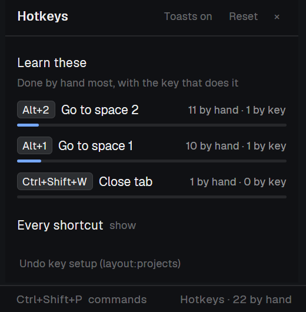

# Hotkeys: a shortcut coach for Herdr

**You click a tab. Herdr tells you the key you could have pressed, and keeps count.**



Most of us learn shortcuts by reading a cheat sheet once and forgetting it. Hotkeys catches you when it matters: right after you reach for the mouse.

- **A toast when you do it by hand.** Switch a space, split a pane, close a tab or hide the sidebar with the mouse, and a toast shows the key: `Alt+2 · Go to space 2 · by hand 11×, 1 by key`.
- **A "Learn these" list.** It ranks what you do by hand most, with a bar for how much of it you already do by key. Watch the bars fill up.
- **"Could use a key".** Things you keep doing that have no shortcut, each with a one-click **Bind** button for a free key.
- **Every shortcut**, on one sheet, with the numbered ones collapsed (`Alt+1…9`).
- **A daily count** in the bar: `Hotkeys · 4 by hand`.

## Install

Paste this to the agent in your Herdr:

```
Add the Herdr mod at github.com/floAr/herdr-hotkeys
```

Then click **Hotkeys · set up** at the bottom of the window and press **Set up keys**.

## Why "Set up keys"?

Herdr runs a command the same way whether you pressed a key or clicked, so a mod can't tell the two apart. Set up keys copies your existing shortcuts for moving around (spaces, tabs, panes, the sidebar) into your layout's section of `keys.json`, pointed at Hotkeys. Each key still does exactly what it did; Hotkeys just notes "that was a key" before passing it on. Anything that changes on screen without a key just before it was done by hand.

- **Per layout, built from your own keys,** so Mac keys and custom layouts work.
- **Undo key setup** removes every routed key again.
- **One trade-off:** while the routing is in place, if a Herdr update changes the default for one of those keys, that layout keeps the old binding.

## What it touches

- **No network, and it runs no programs.**
- **The only file it writes is `keys.json`,** and only when you press Set up keys, Undo or Bind.
- **Scripts and agents don't count.** Changes made while the window isn't focused are ignored.
- **Stats stay in Herdr's shared state** (`coach.stats`). **Reset** clears them.

## Make it yours

[`RECIPE.md`](RECIPE.md) describes the whole mod, so your agent can rebuild it to your taste, for example as a chip in your own status bar or in a side panel instead of the bottom strip.

MIT licensed.
