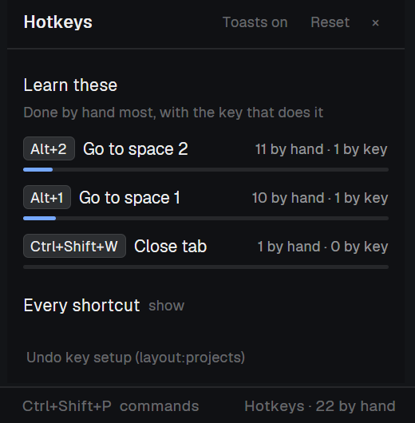

# Hotkeys

A coach for Herdr's shortcuts. When you do something by mouse that has a key (switch a tab, split a pane, hide the sidebar, open a panel), a toast shows the key and how often you've done it by hand. A list ranks what you do by hand most, offers a free key for things that have none, and shows every shortcut.

## What you see

- **The bar:** a 26 px strip along the bottom of the window (`chrome` background, `border` line on top). On the right it reads `Hotkeys · 4 by hand` in 11.8 px `dim` text: how many things you did by hand today that have a key. Before the keys are set up it reads `Hotkeys · set up`. Clicking it opens the list.
- **The toast:** title = the key or keys (`Ctrl+2`, `Alt+]  Ctrl+Tab`), body = `Go to tab 2 · by hand 7×, 3 by key`. Info level, 3.5 s.
- **The list:** a 440×560 dialog. If the layout has a side-panel stack `panel-body` with a child `hotkeys`, it opens there instead. Contents:
  - A header with `Hotkeys`, a `Toasts on/off` toggle, `Reset` (asks again: `Really reset?`) and `×`.
  - Until the keys are set up: a card explaining why they're needed, with a `Set up keys` button.
  - **Learn these:** each thing you did by hand that has a key. It shows the key chips, the action, `N by hand · M by key`, and a 3 px bar for how much you already do by key (`done` color).
  - **Could use a key:** things done by hand that nothing is bound to. Each has a `Bind Ctrl+Shift+J` button that offers the first free key from a spare list.
  - **Every shortcut**, folded: every global binding, with numbered ones collapsed (`Alt+1…9  Go to space 1–9`).
  - At the bottom: `Undo key setup (layout:<name>)`.

## How it behaves

- Herdr runs every command the same way, whether it came from a key or a click, so a mod can't tell them apart. The fix: **Set up keys** copies every global shortcut whose action matches `^(space|tab|pane|agent)\.|^layout\.(toggle|switch)` into keys.json's `layout:<shown layout>` section as `coach.<action>` (e.g. `"alt-1": "coach.space.select:1"`). The bar copy receives those through `nextCommand()`, notes the time, and runs the real command. Keys the layout section already binds are left alone. Undo removes every `coach.*` entry, and the section too if it ends up empty.
- On every render (Herdr re-renders mods when spaces, panes or the layout change), the bar copy compares a snapshot with the previous one: the layout, the spaces and the active one, the tabs and the active one, tab and space names, put-away tabs, panes, the focused pane, zoom, the sidebar's `hidden`, and which `panel-body` child is open. Each difference maps to the commands a key could have done (`space.select:N`, `space.next/prev`, `tab.new/close/select/next/prev/rename/settle`, `pane.split/close/zoom/go`, `space.new/rename`, `layout.toggle:sidebar`, `layout.switch`, `panel:<child>`, `panel.hide`).
  - A routed key within 1.5 s before the change means it was done by key: `used + 1`.
  - Otherwise, if the window is focused (scripts and agents act too), it was done by hand: `missed + 1`, plus a toast if it has a key. The same action toasts at most once every 4 s.
  - Before the keys are set up, nothing is counted.
- Only the tab you were on closing counts as you closing it. A space closing under you doesn't count as picking another space.
- **Bind** writes the spare key to `global` (the plain action) and to the layout section (routed), then confirms with a success toast.
- State lives in shared values: `coach.stats` (`{ [action]: { used, missed, at } }`), `coach.today` (`{ date, missed }`) and `coach.muted`.

## Built from

- `mods/coach/main.js`, one mod in two roles:
  - no props: the bar, which watches, counts and toasts
  - `props: { view: "panel" }`: the list
- `mod.json` docks the bar at the bottom on first sight (`place: "bottom"`, `size: 26`).
- **herdr functions:**
  - state: `spaces`, `panes`, `focused`, `layout`, `keys`, `shared`, `setShared`, `props`, `window`, `theme`
  - acting: `run`, `notify`, `nextCommand`, `openOverlay`, `closeOverlay`
  - files: `appHome`, `readTextFile`, `writeTextFile` (keys.json only, with the read text as the expected version)
- **Commands:** `layout.show`, `layout.hide`, `layout.select`, plus whatever routed keys carry.
- No network, no programs, and no files other than `keys.json`.

## Watch out

- Routed commands are named after the mod (`coach.<action>`). If you install it under another name, rename those prefixes and the `mod: "coach"` in `openOverlay`.
- Routing copies key bindings into the layout section. While they're there, changes Herdr makes to those defaults won't reach that layout. If the mod is removed or broken, the routed keys stop working: Undo first, or delete the `coach.*` entries from keys.json.
- The routing is per layout. Switching to another layout shows `set up` again for that one.
- The spare keys (`ctrl-shift-j/m/u/y/g/d/r`, `alt-s/d/f/g`) were picked on Windows. On a Mac you may prefer cmd-based ones.
- The snapshot runs inside `render()`. Shared values are written on the next microtask, because writing them during a render re-renders everything.
- A layout with its own status row can host the bar there instead (`{ mod: "coach" }` in a fixed-width block) and add `{ id: "hotkeys", content: { mod: "coach", props: { view: "panel" } } }` to its `panel-body` stack. Then remove the docked strip.
